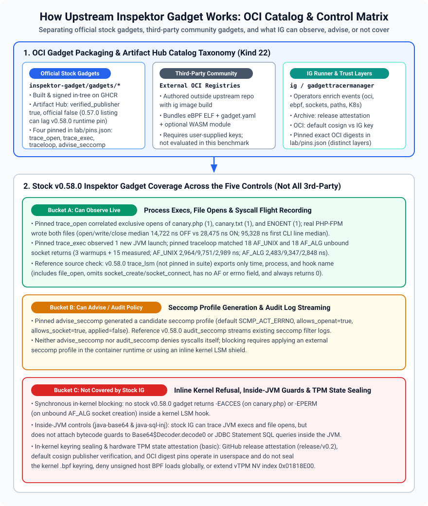

# Tracing Before Blocking: Inspektor Gadget and Shirudo on Azure

By Johnson Shi

When a real patch for a live PHP-FPM service is still being tested and rolled out, I have a practical decision to make: should I block new `.php` files right away, or trace which worker actually creates them first?

That question is what drew me to upstream [Shirudo](https://github.com/shirudo-dev/shirudo) and the companion [Shirudo-on-Azure](https://github.com/johnsonshi/shirudo-on-azure#readme) before/during/after test design. Shirudo can temporarily refuse selected kernel or Java operations in a running service while an actual patch is tested and deployed. It is not a replacement for patching, and a refused call is not proof of vulnerability detection.

IG-Shield is an independent Azure VM lab I built to run unmodified [Inspektor Gadget v0.58.0](https://github.com/inspektor-gadget/inspektor-gadget/releases/tag/v0.58.0) through that same before/during/after check. This is not a contest. Shirudo blocked a selected file open; these stock Inspektor Gadget tools reported system calls and suggested a policy without blocking anything.

## The two-file PHP-FPM control

On both VMs, a PHP-FPM worker process attempted to create two innocuous control files (`canary.php` and `canary.txt`), never executing them. This is not an exploit or a production workload. On the companion Shirudo VM, the test loaded a signed app-sandbox rule. On the Inspektor Gadget VM, the test ran stock `trace_open`.

| Phase | Shirudo VM | IG VM |
| :--- | :--- | :--- |
| Before | Worker wrote `canary.php` and `canary.txt` | Worker wrote `canary.php` and `canary.txt` |
| During | Worker could not create `canary.php` (`EACCES`, `Permission denied`); wrote `canary.txt` | Worker wrote both; `trace_open` logged 1 open per file |
| After | Worker wrote `canary.php` and `canary.txt` | Worker wrote `canary.php` and `canary.txt` |

On the IG VM, `trace_open` named the PHP-FPM worker on each matching open event. Independently, the IG workload read back the same 12-byte harmless text `control-only` for every successful file, because an open event alone does not prove a write happened. The IG guest also ran a deliberate missing-file read in every phase, which returned `ENOENT` throughout; that is a normal missing-file error, not a security block.

Before blocking in production, I treat those observations as a safety check. A legitimate updater or plugin can create `.php` files. Tracing a representative workload first lets me see which process opens which path, narrow any proposed mitigation, and test both allowed text writes and deny cases in staging before enforcing a rule.


[Editable Mermaid source for the boundary diagram](../figures/ig-vs-shirudo-boundaries.mmd)

In short, stock `trace_open` reports open results asynchronously to an operator, including failed opens, without altering the kernel decision. A Shirudo rule evaluates the operation inline and can return `EACCES` before the open succeeds.

## What the other three stock gadgets showed

I also ran three other pinned upstream gadgets on the Inspektor Gadget VM:

- `trace_exec` recorded one `java` process launch. Inside that harmless Java check, valid Base64 decoded `control`, a scalar H2 in-memory query returned `7`, and a fixed false predicate returned no rows. The application, not the tracer, supplied those results.
- `traceloop` captured 18 unbound local Unix socket creations and 18 Linux kernel crypto socket creations during tracing. All 36 succeeded and closed without connecting or sending data.
- `advise_seccomp` suggested an allowlist including `openat` and `socket`. I never applied it, and the container kept its baseline seccomp profile.

All four stock gadgets observe or advise rather than block. That describes these four pinned upstream gadgets, not every possible eBPF program.

## Packaging, provenance, and Azure context

Upstream Inspektor Gadget is a [CNCF Sandbox project](https://www.cncf.io/projects/inspektor-gadget/). Stock and community gadgets ship as OCI images, and a catalog listing is a discovery aid rather than proof of publisher, signature, pinned content, or behavioral policy. This run used four pinned upstream images listed in [`lab/pins.json`](../../lab/pins.json), not a custom blocking gadget.



[Editable Mermaid source for the gadget workflow diagram](../figures/ig-community-gadget-workflow.mmd)

Whether a gadget comes from upstream or the community as an OCI image, the runner still needs to verify and pin the image before execution and check whether the gadget observes, advises or audits, or leaves enforcement uncovered.

Microsoft Learn's [Capture real-time system insights from an AKS cluster with Inspektor Gadget](https://learn.microsoft.com/en-us/troubleshoot/azure/azure-kubernetes/logs/capture-system-insights-from-aks) demonstrates diagnosing DNS and file access with Inspektor Gadget on Azure Kubernetes Service. This lab is distinct: I measured a stand-alone Ubuntu Azure VM, not AKS.

## Timing and guest setup

To measure tracer overhead separately from PHP-FPM request timing, I ran an unprivileged loop inside a container pinned to one vCPU on the IG VM. After 3 warmups, it executed 15 measured file operations: open a pre-existing temporary file, truncate and write one byte, and close it.

The app median was `14.722 µs` without `trace_open` and `28.475 µs` with it. The observer median from the start of the file operation to the first matching complete `ig` CLI output line was `95.328 µs`. That observer figure includes formatting, scheduling, and delivery; it is not added time for the app, not a block time, and not a race between systems.

Run this offline from the repository root with Python 3.10+ to verify the saved receipt:

```bash
python3 lab/receipt.py docs/results/ig-azure.json
```

Expected output:

```text
Verified v1 receipt. Timings in nanoseconds (min / median / max):
  off: 10508 / 14722 / 101276 (n=15)
  on: 23407 / 28475 / 102236 (n=15)
  first_open_event: 54052 / 95328 / 152555 (n=15)
```

Both Azure guests started from the same Ubuntu 26.04 image and VM size, not the same configuration. The IG guest ran a stock kernel with Secure Boot on; the Shirudo guest ran a custom BPF LSM kernel with Secure Boot off. Both used a virtual TPM. The IG tracer attached to an already running PHP-FPM worker, whereas the Shirudo rule associated the worker when it started after rule load.

## Next steps and saved artifacts

Trace a representative workload first to confirm which process touches `.php` paths, then validate any narrow rule in staging while the real patch ships. For the full comparison and saved, sanitized results, see:

- [Full side-by-side comparison](../comparison.md)
- [Reproduction notes](../reproduce.md)
- [Saved, sanitized timing receipt (`ig-azure.json`)](../results/ig-azure.json)
- [Pinned gadget image digests (`lab/pins.json`)](../../lab/pins.json)
