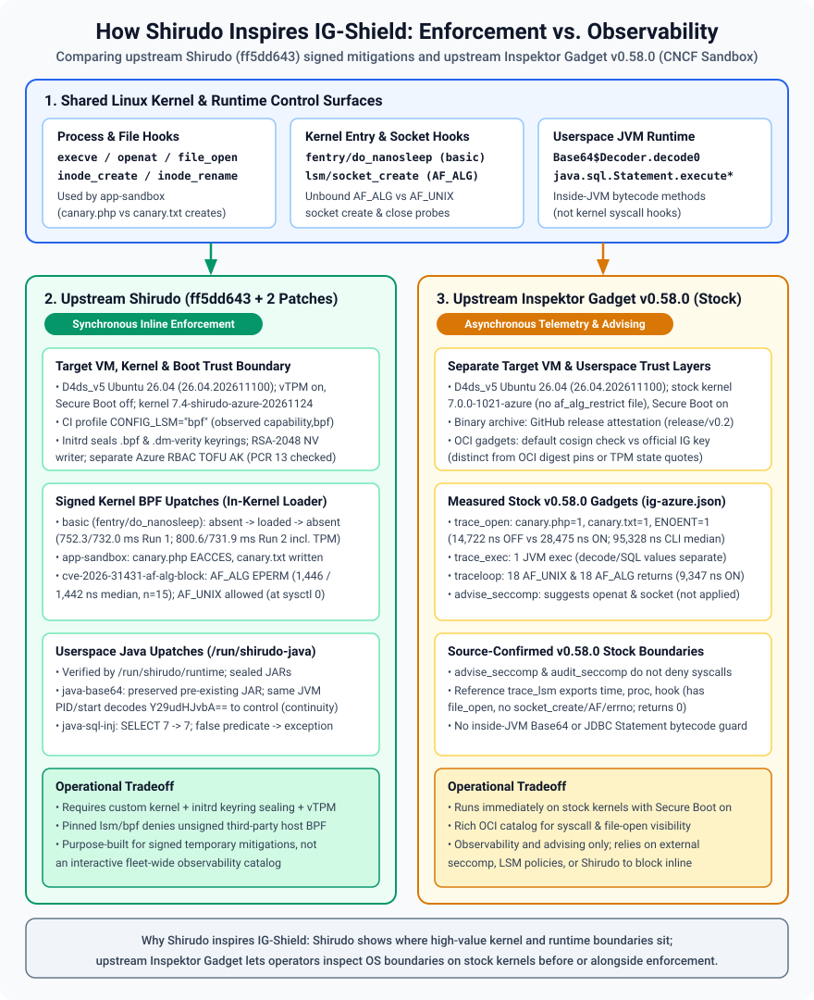

# How Shirudo Inspires IG-Shield: Comparing Upstream Shirudo and Inspektor Gadget on Azure

By Johnson Shi

When I built my earlier [Shirudo-on-Azure lab](https://github.com/johnsonshi/shirudo-on-azure/tree/a989c9e7551be2059f9bb3f8ee16b3965e7bd373), I wanted to see how an operator-signed temporary vulnerability mitigation framework behaves on a real Azure Trusted Launch virtual machine. That work inspired a direct follow-up question for this `IG-Shield` project. If I take the exact same five defensive control scenarios from my Shirudo run and point stock upstream [Inspektor Gadget](https://github.com/inspektor-gadget/inspektor-gadget) ([`v0.58.0`](https://github.com/inspektor-gadget/inspektor-gadget/releases/tag/v0.58.0), source commit [`461906a52de982c1b1ad80f9c2faaa9595c47550`](https://github.com/inspektor-gadget/inspektor-gadget/tree/461906a52de982c1b1ad80f9c2faaa9595c47550)) at them, what can a community catalog of stock observability gadgets see, what can it advise or audit, and where does inline enforcement still require a tool like Shirudo?

Take note: `IG-Shield` is not meant to compete with Shirudo, and I am not writing a custom enforcement gadget to paper over missing capabilities. Upstream [Inspektor Gadget](https://www.cncf.io/projects/inspektor-gadget/) is a CNCF Sandbox project focused on packaging eBPF observability and policy-advising programs as OCI container images, distinct from this independent `IG-Shield` repository. Shirudo ([`shirudo-dev/shirudo`](https://github.com/shirudo-dev/shirudo) at [`ff5dd643ac0b3d68310450a2cb9b668416eac036`](https://github.com/shirudo-dev/shirudo/tree/ff5dd643ac0b3d68310450a2cb9b668416eac036)) is a signed temporary vulnerability mitigation framework that blocks specific kernel and JVM operations synchronously and records every active payload in a virtual TPM register. Putting them side by side on the same five controls clarifies how observability and inline mitigation fit together in practice.

*Figure 1: Shared Linux kernel and JVM control surfaces across upstream Shirudo (`ff5dd643ac0b3d68310450a2cb9b668416eac036` plus two disclosed Azure patches) and stock upstream Inspektor Gadget (`v0.58.0`, `461906a52de982c1b1ad80f9c2faaa9595c47550`). Editable Mermaid source: [`../figures/ig-vs-shirudo-boundaries.mmd`](../figures/ig-vs-shirudo-boundaries.mmd).*

---

## Two Separate Azure Target VMs and Their Kernel Boundaries

To keep the comparison grounded in real guest measurements, both phases use isolated Azure West US 3 `Standard_D4ds_v5` target VMs provisioned from the exact same Canonical Ubuntu 26.04 LTS Marketplace image (`26.04.202611100`), while preserving each tool's actual kernel and boot boundary:

1. **Phase 1 Shirudo Target VM ([`johnsonshi/shirudo-on-azure@a989c9e7551be2059f9bb3f8ee16b3965e7bd373`](https://github.com/johnsonshi/shirudo-on-azure/tree/a989c9e7551be2059f9bb3f8ee16b3965e7bd373)):** A Trusted Launch `Standard_D4ds_v5` guest with **vTPM enabled (`vtpm = true`)** and **Secure Boot disabled (`secure_boot = false`)** so it can boot an unsigned custom Unified Kernel Image (`7.4-shirudo-azure-20261124`, package `7.4-202611240310.g2bf3351c5f89` from `bpf-next` commit `2bf3351c5f894697e8443eeef5333d4c4ce90cab`). Its kernel combines upstream Shirudo's CI profile (`CONFIG_LSM="bpf"`, observed active LSMs `capability,bpf`) with Hyper-V synthetic storage, network, and EFI variable drivers ([`kernel/azure.conf`](https://github.com/johnsonshi/shirudo-on-azure/blob/a989c9e7551be2059f9bb3f8ee16b3965e7bd373/kernel/azure.conf)), plus two disclosed patches to upstream Shirudo [`ff5dd643ac0b3d68310450a2cb9b668416eac036`](https://github.com/shirudo-dev/shirudo/tree/ff5dd643ac0b3d68310450a2cb9b668416eac036): sizing the per-boot TPM NV writer RSA primary key from 3072 bits to 2048 bits (`nv_writer_rsa_bits = 2048`) for Azure's vTPM ([`0001-tpm-size-the-NV-writer-key-for-vTPMs-without-RSA-307.patch`](https://github.com/johnsonshi/shirudo-on-azure/blob/a989c9e7551be2059f9bb3f8ee16b3965e7bd373/patches/shirudo/0001-tpm-size-the-NV-writer-key-for-vTPMs-without-RSA-307.patch)) and retrying boot-image `dm-verity` teardown while `udev` probes devices in `dracut` ([`0002-init-retry-boot-image-teardown-while-udev-probes-the.patch`](https://github.com/johnsonshi/shirudo-on-azure/blob/a989c9e7551be2059f9bb3f8ee16b3965e7bd373/patches/shirudo/0002-init-retry-boot-image-teardown-while-udev-probes-the.patch)). A separate `Standard_D32ds_v5` operator VM (`secure_boot = true`, `vtpm = true`) holds the offline signing keys and verifies TPM quotes.
2. **Phase 2 Inspektor Gadget Target VM (`IG-Shield`, [`../results/ig-azure.json`](../results/ig-azure.json)):** A separate West US 3 `Standard_D4ds_v5` guest from the same Canonical Ubuntu 26.04 base image (`26.04.202611100`), running stock Azure kernel `7.0.0-1021-azure` (`af_alg_restrict = null`, exposing no `/proc/sys/crypto/af_alg_restrict` sysctl file) with **Secure Boot enabled (`secure_boot = true`)**, **vTPM enabled (`vtpm = true`)**, and an isolated NIC network security group whose first inbound rule denies all traffic (`inbound = "deny_all"`). After the run, the VM is confirmed deallocated (`power = "deallocated"`) with its original OS disk `Reserved` and still bound to the same VM (`original_os_disk = "retained_and_bound"`).

That deployment difference is the first practical takeaway. Stock Inspektor Gadget runs immediately on a standard distribution kernel with Secure Boot turned on. Shirudo requires a custom kernel build and initrd keyring sealing, and once booted, its pinned `lsm/bpf` policy denies unsigned host BPF loads across the guest.

---

## How Upstream Inspektor Gadget and Its Community Catalog Work

Meanwhile as a refresher, Inspektor Gadget does not ship a monolithic agent with hard-coded probes. Since its image-based architecture matured, every "gadget" is packaged and distributed as an OCI artifact in a container registry:

- **What is inside an OCI gadget image:** An eBPF ELF object compiled with BTF CO-RE relocations, a metadata manifest (`gadget.yaml`) defining exported fields, parameters, and operators (`oci`, `ebpf`, `socketenricher`, `uidgidresolver`, `kallsyms`), and an optional WebAssembly (`.wasm`) module for userspace formatting or filtering.
- **Official stock gadgets vs. third-party community gadgets:** Upstream maintains a catalog of official stock gadgets in-tree under [`gadgets/`](https://github.com/inspektor-gadget/inspektor-gadget/tree/v0.58.0/gadgets) and publishes them to `ghcr.io/inspektor-gadget/gadget/<name>:<tag>`. Anyone in the community can also build and publish third-party gadgets to their own OCI registry using `ig image build` and list them on Artifact Hub under repository kind `22` ([Inspektor Gadgets repositories guide](https://github.com/artifacthub/hub/blob/master/docs/inspektor_gadgets_repositories.md)). Provenance from the upstream in-tree repository and GHCR is not identical to Artifact Hub's badge fields: when checked via the Artifact Hub API (`https://artifacthub.io/api/v1/packages/inspektor-gadget/gadgets/trace-open`), the `inspektor-gadget/gadgets/trace-open` package record reported `verified_publisher: true`, `official: false`, and catalog version `0.57.0` (showing that a catalog entry can lag the `v0.58.0` runtime pin).
- **The four stock `v0.58.0` gadgets pinned in `IG-Shield`:** Rather than writing a custom gadget, [`../../lab/pins.json`](../../lab/pins.json) pins four stock upstream `v0.58.0` gadgets (`461906a52de982c1b1ad80f9c2faaa9595c47550`): [`trace_open`](https://github.com/inspektor-gadget/inspektor-gadget/tree/v0.58.0/gadgets/trace_open), [`trace_exec`](https://github.com/inspektor-gadget/inspektor-gadget/tree/v0.58.0/gadgets/trace_exec), [`traceloop`](https://github.com/inspektor-gadget/inspektor-gadget/tree/v0.58.0/gadgets/traceloop), and [`advise_seccomp`](https://github.com/inspektor-gadget/inspektor-gadget/tree/v0.58.0/gadgets/advise_seccomp).

*Figure 2: OCI gadget catalog taxonomy and the three-bucket capability split across the five control surfaces for stock `v0.58.0` Inspektor Gadget. Editable Mermaid source: [`../figures/ig-community-gadget-workflow.mmd`](../figures/ig-community-gadget-workflow.mmd).*

---

## Separating the Four Layers of Trust

When comparing how Shirudo and Inspektor Gadget verify what runs on a host, it helps to keep four distinct trust layers separate:

1. **Binary release attestation (`release/v0.2`):** On the workstation, running `gh release verify-asset v0.58.0 ig-linux-amd64-v0.58.0.tar.gz -R inspektor-gadget/inspektor-gadget` verified GitHub's immutable release attestation (`https://in-toto.io/attestation/release/v0.2`) on the `v0.58.0` archive whose SHA-256 and inner `ig` executable match [`../../lab/pins.json`](../../lab/pins.json). That proves the release archive came from the official GitHub release. It is not SLSA build provenance, gadget OCI signer verification, or attestation of which gadgets are running on a VM.
2. **Publisher signature verification (in-kernel BPF vs. userspace Java vs. OCI):**
   - In **Inspektor Gadget**, [`docs/reference/verify-gadgets.mdx` (`v0.58.0`)](https://github.com/inspektor-gadget/inspektor-gadget/blob/v0.58.0/docs/reference/verify-gadgets.mdx) documents that `ig` verifies stock OCI gadget signatures in userspace by default (`--verify-image=true`) using `cosign` against the embedded official Inspektor Gadget public key.
   - In **Shirudo**, kernel BPF and userspace Java verification use two separate mechanisms. Kernel BPF `.upatch` files compile into signed in-kernel BPF loader programs verified by the Linux kernel against the `.bpf` keyring sealed in the initrd (`lsm/bpf` rejects unsigned BPF loads). Userspace Java `.upatch` packages are verified by the `shirudo` userland runtime mounted at `/run/shirudo/runtime` (`/run/shirudo/runtime/usr/bin/shirudo`), and signed agent JARs are sealed under `/run/shirudo-java` with the `security.bpf.shirudo` extended attribute.
3. **Artifact digest pinning:** In [`../../lab/pins.json`](../../lab/pins.json), my runner pins the exact OCI image digests for `trace_open`, `trace_exec`, `traceloop`, and `advise_seccomp`. In Shirudo, every owned `.upatch` unload is bound to the loaded artifact's `payload_sha256` and verified against `--expect-chain`.
4. **Hardware TPM state attestation:** Shirudo binds TPM NV index `0x01818E00` in the initrd (`bound_in = "initrd"`) and extends it on every signed load and unload. Before and after both Phase 1 runs, fresh-nonce TPM quotes verified offline (`fresh_before_and_after = true`, `wrong_nonce_rejected = true`, `operator_signed_config_root_pcr = 13`, `final_register = "verified_baseline_plus_planned_signed_payload_transitions"`, with lab caveats `ak_enrollment = "separate_Azure_RBAC_TOFU"`, `ek_endorsement_verified = false`, `azure_guest_attestation_service_used = false`, `historical_intent_approved = false`). Stock Inspektor Gadget does not extend a TPM register or attest running gadget state.

---

## Walking Through the Five Control Scenarios

In Phase 1 ([`johnsonshi/shirudo-on-azure@a989c9e7551be2059f9bb3f8ee16b3965e7bd373`](https://github.com/johnsonshi/shirudo-on-azure/tree/a989c9e7551be2059f9bb3f8ee16b3965e7bd373)), I recorded two unpooled JSON receipts on the Shirudo guest (`measured_utc = "2026-11-24"`, OpenJDK `25.0.5.1+2-1~26.04.1`, kernel `7.4-shirudo-azure-20261124`): Run 1 using minimal fixed local fixtures ([`docs/results/azure-controls.json`](https://github.com/johnsonshi/shirudo-on-azure/blob/a989c9e7551be2059f9bb3f8ee16b3965e7bd373/docs/results/azure-controls.json)) and Run 2 using genuine Ubuntu 26.04 `php8.5-fpm` and `libh2-java` packages ([`docs/results/azure-controls-real-runtimes.json`](https://github.com/johnsonshi/shirudo-on-azure/blob/a989c9e7551be2059f9bb3f8ee16b3965e7bd373/docs/results/azure-controls-real-runtimes.json)). Here is how each control works in Shirudo and how it maps to stock `v0.58.0` Inspektor Gadget.

### 1. `basic`: Signed BPF Lifecycle (`fentry/do_nanosleep`)

In Shirudo, [`testing/fixtures/basic.bpf.c`](https://github.com/shirudo-dev/shirudo/blob/ff5dd643ac0b3d68310450a2cb9b668416eac036/testing/fixtures/basic.bpf.c) is a minimal `SEC("fentry/do_nanosleep")` fixture that validates the owned load and digest-bound unload lifecycle (`lifecycle = "owned_pair"`, `before = "absent"`, `during = "loaded_and_measured"`, `after_unload = "absent"`). Including the synchronous vTPM `NV_Extend` operation on the guest monotonic clock, one signed CLI load took **752.294 ms** and unload took **732.024 ms** in Run 1, and **800.637 ms** load / **731.906 ms** unload in Run 2.

In stock Inspektor Gadget (`v0.58.0`), the `ig` binary and the four pinned OCI gadgets are verified in userspace via GitHub release attestation (`release/v0.2`), default `cosign` signature verification against the official IG public key, and exact OCI digest pins in [`../../lab/pins.json`](../../lab/pins.json). However, stock IG does not seal the kernel `.bpf` keyring, block unsigned third-party `BPF_PROG_LOAD` calls on the host, or record active tracer lifecycles in a vTPM register.

### 2. `java-base64`: Live JVM Continuity (`Base64$Decoder.decode0`)

In Shirudo, [`upatches/java-base64`](https://github.com/shirudo-dev/shirudo/tree/ff5dd643ac0b3d68310450a2cb9b668416eac036/upatches/java-base64) instruments `java.util.Base64$Decoder.decode0` inside a running JVM using the JDK Class-File API. On the target guest, the pre-existing sealed `/run/shirudo-java/java-base64.jar` (`initial_count = 1`) was preserved throughout both runs (`lifecycle = "preserved_preexisting"`, `operation_ms = {}`, `scope = "continuity_only"`). A single long-lived unprivileged JVM (`Control base64`) decoded the valid base64 string `"Y29udHJvbA=="` to `"control"` before attach (`before = "control"`), attached the sealed agent (`upstream_install_diagnostic = true`, `sealed_jar = true`), and decoded `"Y29udHJvbA=="` to `"control"` again (`after_attach = "control"`) with the exact same PID and `/proc/<pid>/stat` start time (`same_pid_and_jvm_start = true`).

Stock Inspektor Gadget (`v0.58.0`) operates at the Linux kernel boundary. In [`../results/ig-azure.json`](../results/ig-azure.json) (`openjdk-25-jdk-headless = "25.0.5.1+2-1~26.04.1"`), the valid Base64 decode returned `"control"` across `before`, `during`, and `after`. Signed [`trace_exec`](https://github.com/inspektor-gadget/inspektor-gadget/tree/v0.58.0/gadgets/trace_exec) observed `exec_events = 1` for the single new JVM launch, while the decoded bytes (`"control"`) come from the Java workload's own output rather than the `trace_exec` event fields.

### 3. `app-sandbox`: Web Worker File-Create Policy (`canary.php` vs. `canary.txt`)

In Shirudo, [`upatches/app-sandbox`](https://github.com/shirudo-dev/shirudo/tree/ff5dd643ac0b3d68310450a2cb9b668416eac036/upatches/app-sandbox) attaches BPF LSM hooks (`bprm_committed_creds`, `file_open`, `inode_create`, `inode_rename`, `task_fix_setuid`) that tag `httpd` and `php-fpm` worker trees on exec (`first_exec_after_load = true`) and deny creating or opening writable `.php` files. The control fixture attempts to write `b"control-only"` to `canary.php` and `canary.txt` (`order = [".php", ".txt"]`) in a temporary directory:
- In Run 1 (`fixture = "private_PHP_FPM_name_on_distro_Python"`, `real_php_fpm = false`, load **781.100 ms** / unload **745.401 ms**), outcomes transitioned from `before = ["written", "written"]` to `after_load = ["EACCES", "written"]` and back to `after_unload = ["written", "written"]`.
- In Run 2 (`fixture = "Ubuntu_PHP_FPM_one_worker_private_Unix_socket"`, `real_php_fpm = true`, `php8.5-fpm` `8.5.4-0ubuntu1.6` and `libargon2-1` `0~20190702+dfsg-5` in a private network namespace over a mode-`0600` local Unix socket, load **791.798 ms** / unload **742.516 ms**), the real PHP-FPM worker produced the exact same transition: `["written", "written"]` -> `["EACCES", "written"]` -> `["written", "written"]`.

Separately, in [`../results/ig-azure.json`](../results/ig-azure.json) (`php8.5-fpm = "8.5.4-0ubuntu1.6"`), the real PHP-FPM worker wrote both `canary.php` and `canary.txt` plus a genuine `ENOENT` negative control across all three phases (`before = ["written", "written", "ENOENT"]`, `during = ["written", "written", "ENOENT"]`, `after = ["written", "written", "ENOENT"]`). Signed [`trace_open`](https://github.com/inspektor-gadget/inspektor-gadget/blob/v0.58.0/gadgets/trace_open/program.bpf.c) correlated exclusive opens of each plus `ENOENT` (`events = {"canary.php": 1, "canary.txt": 1, "ENOENT": 1}`). Take note of two source-level distinctions in `v0.58.0`: first, `trace_open` emits file opens, not proof that content bytes were written to disk, so the positive tracer marker and the application's own write outcome are verified separately. Second, even if you inspect upstream's reference [`gadgets/trace_lsm/program.bpf.c`](https://github.com/inspektor-gadget/inspektor-gadget/blob/v0.58.0/gadgets/trace_lsm/program.bpf.c) (not pinned in my suite), it exports only timestamp, process metadata, and LSM hook name (`file_open` is in its hook list, with no `errno` field) and ends every handler with `return 0;`. Stock IG observes the opens without denying `canary.php`.

### 4. `java-sql-inj`: JDBC `Statement` Guard (`SELECT 7` vs. Harmless False Predicate)

In Shirudo, [`upatches/java-sql-inj/agent`](https://github.com/shirudo-dev/shirudo/tree/ff5dd643ac0b3d68310450a2cb9b668416eac036/upatches/java-sql-inj/agent) is a sealed Byte Buddy startup agent (`/run/shirudo-java/java-sql-inj.jar`, `sealed_jar = true`) that inspects `java.sql.Statement` executions inside the JVM. In [`demos/controls/Control.java`](https://github.com/johnsonshi/shirudo-on-azure/blob/a989c9e7551be2059f9bb3f8ee16b3965e7bd373/demos/controls/Control.java), each JVM executes two fixed SQL constants against an empty in-memory database: a fixed scalar read (`SELECT 7`) and a fixed harmless false arithmetic predicate (`SELECT 7 WHERE 8 > 3 AND 4 = 5`):
- In Run 1 (`fixture = "mock_JDBC_Statement_with_empty_in_memory_SQLite"`, load **756.211 ms** / unload **733.741 ms**), `fixed_read` returned **`7`** across all three phases, while `fixed_false_predicate` returned `"empty"` before load, threw `"policy-exception"` (`SecurityException`) in a newly started protected JVM after load (`after_load_new_jvm`), and returned `"empty"` again in a newly started JVM after unload (`after_unload_new_jvm`).
- In Run 2 (`fixture = "Ubuntu_H2_JDBC_Statement_with_empty_in_memory_database"`, using Ubuntu package `libh2-java` `2.2.220-1build1`, load **756.651 ms** / unload **744.478 ms**), the real H2 JDBC driver produced the exact same outcomes: `fixed_read = 7` throughout, and `fixed_false_predicate` transitioning `"empty"` -> `"policy-exception"` -> `"empty"`.

Just as with `java-base64`, in [`../results/ig-azure.json`](../results/ig-azure.json) (`libh2-java = "2.2.220-1build1"`), the H2 fixed read stayed **`7`** and the fixed harmless false predicate stayed **`"empty"`** across `before`, `during`, and `after` (with no policy exception). Signed `trace_exec` observed the single new JVM launch (`exec_events = 1`), and its exec event does not reveal the SQL statements or query results.

### 5. `cve-2026-31431-af-alg-block`: Unbound `AF_ALG` vs. `AF_UNIX` Socket Probes

In Shirudo, [`cve-2026-31431-af-alg-block.bpf.c`](https://github.com/shirudo-dev/shirudo/blob/ff5dd643ac0b3d68310450a2cb9b668416eac036/upatches/kernel-cve/sources/cve-2026-31431-crypto-algif-aead-copy-fail/mitigation/cve-2026-31431-af-alg-block.bpf.c) attaches to `SEC("lsm/socket_create")` and returns `-EPERM` when `family == AF_ALG` (`38`), leaving other socket families untouched. My unprivileged probe (`fixture = "unprivileged_unbound_socket_create_and_close"`) executes `3` warmups followed by `n = 15` measured unbound socket create/close calls per family (`AF_UNIX` `SOCK_DGRAM` and `AF_ALG` `SOCK_SEQPACKET`) per phase on the guest monotonic clock, recording the guest median (`median_ns`):
- **Run 1 ([`azure-controls.json`](https://github.com/johnsonshi/shirudo-on-azure/blob/a989c9e7551be2059f9bb3f8ee16b3965e7bd373/docs/results/azure-controls.json), load `739.570 ms` / unload `727.428 ms`):**
  - `AF_ALG`: `allowed` (**1,890 ns/call** median, `n = 15`) before load -> `EPERM` (**1,446 ns/call** median, `n = 15`) after load -> `allowed` (**1,886 ns/call** median, `n = 15`) after unload.
  - `AF_UNIX`: `allowed` in all three phases (**2,058 ns/call** -> **2,122 ns/call** -> **1,985 ns/call** median, `n = 15`).
- **Run 2 ([`azure-controls-real-runtimes.json`](https://github.com/johnsonshi/shirudo-on-azure/blob/a989c9e7551be2059f9bb3f8ee16b3965e7bd373/docs/results/azure-controls-real-runtimes.json), load `746.745 ms` / unload `730.422 ms`):**
  - `AF_ALG`: `allowed` (**1,952 ns/call** median, `n = 15`) before load -> `EPERM` (**1,442 ns/call** median, `n = 15`) after load -> `allowed` (**1,929 ns/call** median, `n = 15`) after unload.
  - `AF_UNIX`: `allowed` in all three phases (**2,096 ns/call** -> **2,124 ns/call** -> **2,111 ns/call** median, `n = 15`).

Two methodological facts matter when interpreting those `AF_ALG` numbers:
- First, **1,446 ns/call vs. 1,890 ns/call** in Run 1 (and **1,442 ns/call vs. 1,952 ns/call** in Run 2) compares two different kernel code paths: an immediate synchronous `-EPERM` refusal inside `lsm/socket_create` versus full `AF_ALG` socket allocation plus `close(fd)`. That difference is not a speedup.
- Second, as recorded in [`docs/results/azure-af-alg-restoration.json`](https://github.com/johnsonshi/shirudo-on-azure/blob/a989c9e7551be2059f9bb3f8ee16b3965e7bd373/docs/results/azure-af-alg-restoration.json), both Shirudo runs executed while the Shirudo lab VM had a pre-existing `crypto.af_alg_restrict = 0` sysctl (`af_alg_restrict_unchanged = 0`). Afterward, separate housekeeping verified that `crypto/af_alg.c:32` in the running kernel's source commit (`2bf3351c5f894697e8443eeef5333d4c4ce90cab`) initializes `expected_build_default = 1` with `config_override_found = false`, and restored `crypto.af_alg_restrict` from `0` to `1` without re-probing (`probe_rerun_after_restoration = false`). By contrast, the stock Azure Ubuntu kernel on the Inspektor Gadget target VM (`7.0.0-1021-azure`) does not expose a `crypto.af_alg_restrict` sysctl file at all (`af_alg_restrict = null`).

How did stock `v0.58.0` Inspektor Gadget behave on this control in [`../results/ig-azure.json`](../results/ig-azure.json)? On stock kernel `7.0.0-1021-azure` (`seccomp_mode = 2` in a networkless container fixture pinned to `fixture_cpu = 0`, `unprivileged_host = {"unix": "allowed", "alg": "allowed"}`), both `AF_UNIX` and `AF_ALG` unbound sockets remained `allowed` before, during, and after (`AF_UNIX` medians **2,964 / 9,751 / 2,989 ns/call**; `AF_ALG` medians **2,483 / 9,347 / 2,848 ns/call**, `n = 15` after `3` warmups). Signed [`traceloop`](https://github.com/inspektor-gadget/inspektor-gadget/blob/v0.58.0/gadgets/traceloop/README.mdx) positively observed **18** successful `AF_UNIX` and **18** successful `AF_ALG` unbound socket returns (`matching_events = {"unix": 18, "alg": 18}`, i.e., `3` warmups + `15` measured per family). Signed [`advise_seccomp`](https://github.com/inspektor-gadget/inspektor-gadget/blob/v0.58.0/gadgets/advise_seccomp/README.mdx) suggested a candidate seccomp profile (`default = "SCMP_ACT_ERRNO"`, `allows_openat = true`, `allows_socket = true`) that was not applied (`applied = false`). And if you look at upstream's reference [`gadgets/trace_lsm/program.bpf.c`](https://github.com/inspektor-gadget/inspektor-gadget/blob/v0.58.0/gadgets/trace_lsm/program.bpf.c) in `v0.58.0` (not pinned in my suite), its `FOR_EACH_LSM_HOOK` list includes `file_open` and omits `socket_create` and `socket_connect`, with no address-family or `errno` field. These boundaries are specific to these `v0.58.0` stock gadgets, not an assertion about all third-party gadgets.

---

## Phase 2 Measured Inspektor Gadget Timing & Lifecycle Summary

In [`../results/ig-azure.json`](../results/ig-azure.json) (SHA-256 `baf2fd48515636917e820a731ded92adfd79e87bbea0e5a54d607038b18450cb`), produced by [`../../lab/azure.py`](../../lab/azure.py) against the four pinned stock `v0.58.0` gadgets in [`../../lab/pins.json`](../../lab/pins.json) (SHA-256 `3d5b3bbdde7ac19500d5813322043506ac8bab12fdcea481d5ed92e551202ec4`), the fixture timing benchmark (`n = 15` measured iterations after `3` warmups on `CLOCK_MONOTONIC`, after the tracer readiness marker) separates in-guest syscall duration from end-to-end userspace CLI output delivery:

- **File `open`/`write`/`close` with `trace_open` OFF (`timing.off`):** min **10,508 ns**, median **14,722 ns**, max **101,276 ns**
- **File `open`/`write`/`close` with `trace_open` ON (`timing.on`):** min **23,407 ns**, median **28,475 ns**, max **102,236 ns**
- **Start of fixture call to first matching CLI output line (`timing.first_open_event`):** min **54,052 ns**, median **95,328 ns**, max **152,555 ns** (measuring end-to-end userspace CLI line delivery from the start of the fixture call, not just kernel latency)
- **Socket phase medians (`sockets`, `n = 15` after `3` warmups):** `AF_UNIX` **2,964 / 9,751 / 2,989 ns** (`before` / `during` `traceloop` / `after`); `AF_ALG` **2,483 / 9,347 / 2,848 ns** (`before` / `during` `traceloop` / `after`), with zero new denials.
- **VM Lifecycle (`lifecycle`):** Following measurement, the IG guest VM was confirmed `power = "deallocated"`, with its original OS disk `disk_state = "Reserved"` and still assigned to the same VM (`original_os_disk = "retained_and_bound"`). For the full side-by-side table, see [`../comparison.md`](../comparison.md).

---

## Closing Forecast

Looking at both projects side by side, their boundaries are complementary rather than overlapping. Stock upstream Inspektor Gadget (`v0.58.0`) gives operators immediate, OCI-packaged visibility (`trace_open`, `trace_exec`, `traceloop`) and seccomp profile generation (`advise_seccomp`) on unmodified distribution kernels with Secure Boot enabled. Upstream Shirudo takes on the heavier requirements of a custom `CONFIG_LSM="bpf"` kernel, initrd keyring sealing, and synchronous vTPM `NV_Extend` accounting so that it can refuse vulnerable kernel paths (`-EACCES`, `-EPERM`) and enforce sealed JVM bytecode guards inline.

I think future cloud defense workflows will pair both patterns in a two-stage loop: using stock OCI observability gadgets on standard nodes to inventory syscall and file-access boundaries across a fleet, and reserving signed, TPM-attested LSM shields or container-runtime seccomp profiles for the specific boundaries that require synchronous inline refusal. Perhaps upstream gadget catalogs will eventually standardize read-only capability metadata in `gadget.yaml` so operators can see at a glance whether an OCI artifact is a passive ring-buffer tracer, a policy advisor, or an active LSM enforcer.
