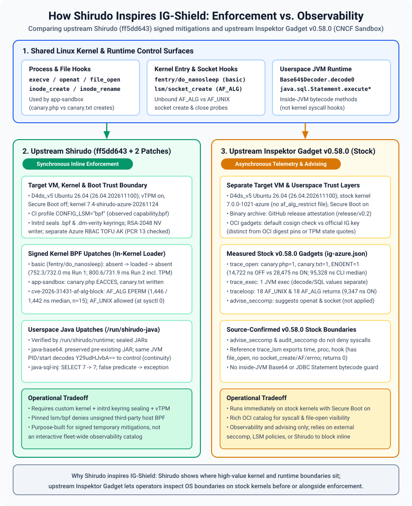
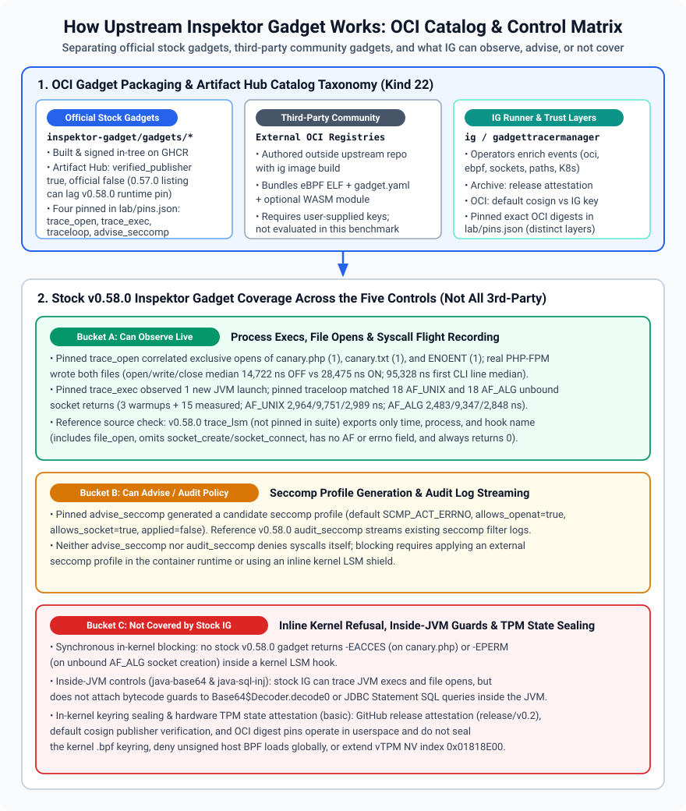

# Side-by-Side Comparison: Upstream Shirudo vs. Upstream Inspektor Gadget (`v0.58.0`)

This document compares two distinct Linux eBPF and runtime projects evaluated against the same five control scenarios on two separate isolated Azure West US 3 `Standard_D4ds_v5` target VMs provisioned from the exact Canonical Ubuntu 26.04 LTS base image (`26.04.202611100`):

1. **Upstream Shirudo** ([`shirudo-dev/shirudo`](https://github.com/shirudo-dev/shirudo) at revision [`ff5dd643ac0b3d68310450a2cb9b668416eac036`](https://github.com/shirudo-dev/shirudo/tree/ff5dd643ac0b3d68310450a2cb9b668416eac036) plus two disclosed Azure compatibility patches in [`johnsonshi/shirudo-on-azure`](https://github.com/johnsonshi/shirudo-on-azure/tree/a989c9e7551be2059f9bb3f8ee16b3965e7bd373)), running custom kernel `7.4-shirudo-azure-20261124` (`CONFIG_LSM="bpf"`, observed active LSMs `capability,bpf`) with **vTPM on** and **Secure Boot off** (`secure_boot = false`).
2. **Upstream Inspektor Gadget** ([`inspektor-gadget/inspektor-gadget`](https://github.com/inspektor-gadget/inspektor-gadget) at official release [`v0.58.0`](https://github.com/inspektor-gadget/inspektor-gadget/releases/tag/v0.58.0), source commit [`461906a52de982c1b1ad80f9c2faaa9595c47550`](https://github.com/inspektor-gadget/inspektor-gadget/tree/461906a52de982c1b1ad80f9c2faaa9595c47550)), a [CNCF Sandbox project](https://www.cncf.io/projects/inspektor-gadget/) (distinct from this independent `IG-Shield` repository), running on a separate `Standard_D4ds_v5` Ubuntu 26.04 (`26.04.202611100`) target VM with stock Azure kernel `7.0.0-1021-azure` (`af_alg_restrict = null`, no `/proc/sys/crypto/af_alg_restrict` sysctl file), **Secure Boot on**, **vTPM on**, and an isolated NIC NSG whose first inbound rule denies all traffic (`inbound = "deny_all"`).

**Framing:** `IG-Shield` is not meant to compete with Shirudo, and it uses no custom gadget to replace missing enforcement capabilities. Instead, Shirudo inspired me to test what stock upstream Inspektor Gadget (`v0.58.0`) and its community catalog of gadgets can observe, what they can advise or audit, and what they do not cover across the exact same five control surfaces.

*Editable Mermaid source: [`figures/ig-vs-shirudo-boundaries.mmd`](figures/ig-vs-shirudo-boundaries.mmd).*

---

## 1. Primary Evidence & Reproducibility Pins

Every measured claim in this comparison is anchored to committed JSON receipts and pinned upstream source trees:

- **Phase 1 Upstream Shirudo Receipts (`johnsonshi/shirudo-on-azure` at [`a989c9e7551be2059f9bb3f8ee16b3965e7bd373`](https://github.com/johnsonshi/shirudo-on-azure/tree/a989c9e7551be2059f9bb3f8ee16b3965e7bd373)):**
  - Run 1 (minimal fixed local fixtures): [`docs/results/azure-controls.json`](https://github.com/johnsonshi/shirudo-on-azure/blob/a989c9e7551be2059f9bb3f8ee16b3965e7bd373/docs/results/azure-controls.json)
  - Run 2 (genuine Ubuntu 26.04 `php8.5-fpm` `8.5.4-0ubuntu1.6`, `libargon2-1` `0~20190702+dfsg-5`, and `libh2-java` `2.2.220-1build1` packages): [`docs/results/azure-controls-real-runtimes.json`](https://github.com/johnsonshi/shirudo-on-azure/blob/a989c9e7551be2059f9bb3f8ee16b3965e7bd373/docs/results/azure-controls-real-runtimes.json)
  - Post-measurement `crypto.af_alg_restrict` housekeeping (`0` restored to `1`): [`docs/results/azure-af-alg-restoration.json`](https://github.com/johnsonshi/shirudo-on-azure/blob/a989c9e7551be2059f9bb3f8ee16b3965e7bd373/docs/results/azure-af-alg-restoration.json)
  - Pinned control fixtures and runner: [`demos/controls/README.md`](https://github.com/johnsonshi/shirudo-on-azure/blob/a989c9e7551be2059f9bb3f8ee16b3965e7bd373/demos/controls/README.md), [`demos/controls/Control.java`](https://github.com/johnsonshi/shirudo-on-azure/blob/a989c9e7551be2059f9bb3f8ee16b3965e7bd373/demos/controls/Control.java), [`demos/controls/target.py`](https://github.com/johnsonshi/shirudo-on-azure/blob/a989c9e7551be2059f9bb3f8ee16b3965e7bd373/demos/controls/target.py), and [`demos/controls/distro.py`](https://github.com/johnsonshi/shirudo-on-azure/blob/a989c9e7551be2059f9bb3f8ee16b3965e7bd373/demos/controls/distro.py)
- **Phase 2 Upstream Inspektor Gadget Pin & Engineering Paths (`IG-Shield`):**
  - Upstream Inspektor Gadget release tag: [`v0.58.0`](https://github.com/inspektor-gadget/inspektor-gadget/releases/tag/v0.58.0) (source commit [`461906a52de982c1b1ad80f9c2faaa9595c47550`](https://github.com/inspektor-gadget/inspektor-gadget/tree/461906a52de982c1b1ad80f9c2faaa9595c47550))
  - Four pinned stock OCI gadgets: `trace_open`, `trace_exec`, `traceloop`, and `advise_seccomp`
  - Tracked engineering pin manifest: [`../lab/pins.json`](../lab/pins.json) (SHA-256 `3d5b3bbdde7ac19500d5813322043506ac8bab12fdcea481d5ed92e551202ec4`)
  - Tracked Azure validation runner: [`../lab/azure.py`](../lab/azure.py)
  - Measured Inspektor Gadget Azure receipt: [`results/ig-azure.json`](results/ig-azure.json) (SHA-256 `baf2fd48515636917e820a731ded92adfd79e87bbea0e5a54d607038b18450cb`)

---

## 2. Architectural, Trust, and Enforcement Comparison

The table below separates VM boot policies, kernel prerequisites, distinct trust layers, and runtime mechanisms between the two setups.

| Dimension | Upstream Shirudo (`shirudo-on-azure@a989c9e7`) | Upstream Inspektor Gadget (`v0.58.0` Stock at `461906a5`) | Operational Implication |
| :--- | :--- | :--- | :--- |
| **Primary Role** | Synchronous temporary vulnerability mitigation (signed in-kernel BPF loader `.upatch` artifacts and sealed userspace Java bytecode agents) with per-boot vTPM measurement. | Asynchronous eBPF system observability, syscall flight recording, and seccomp/network policy advising packaged as OCI container images ("gadgets"). | Shirudo buys rollout time by refusing specific kernel or JVM operations inline; Inspektor Gadget provides live visibility and policy drafting on stock kernels without altering syscall return codes. |
| **Upstream Project & Pin** | [`shirudo-dev/shirudo`](https://github.com/shirudo-dev/shirudo) at [`ff5dd643ac0b3d68310450a2cb9b668416eac036`](https://github.com/shirudo-dev/shirudo/tree/ff5dd643ac0b3d68310450a2cb9b668416eac036) with two disclosed Azure patches: [`0001-tpm-size-the-NV-writer-key-for-vTPMs-without-RSA-307.patch`](https://github.com/johnsonshi/shirudo-on-azure/blob/a989c9e7551be2059f9bb3f8ee16b3965e7bd373/patches/shirudo/0001-tpm-size-the-NV-writer-key-for-vTPMs-without-RSA-307.patch) (`TPM_NV_RSA_BITS=2048`) and [`0002-init-retry-boot-image-teardown-while-udev-probes-the.patch`](https://github.com/johnsonshi/shirudo-on-azure/blob/a989c9e7551be2059f9bb3f8ee16b3965e7bd373/patches/shirudo/0002-init-retry-boot-image-teardown-while-udev-probes-the.patch) (plus dracut module `91shirudo-tpm2-setup`). | [CNCF Sandbox project](https://www.cncf.io/projects/inspektor-gadget/) ([`inspektor-gadget/inspektor-gadget`](https://github.com/inspektor-gadget/inspektor-gadget)) at release [`v0.58.0`](https://github.com/inspektor-gadget/inspektor-gadget/releases/tag/v0.58.0) (`461906a52de982c1b1ad80f9c2faaa9595c47550`), distinct from this independent `IG-Shield` repository. On Artifact Hub ([repository kind 22](https://github.com/artifacthub/hub/blob/master/docs/inspektor_gadgets_repositories.md)), the `inspektor-gadget/gadgets/trace-open` listing reports `verified_publisher: true`, `official: false`, and catalog version `0.57.0` (which can lag the `v0.58.0` GHCR runtime pin). | My IG run uses four stock `v0.58.0` gadgets (`trace_open`, `trace_exec`, `traceloop`, `advise_seccomp`) from `ghcr.io/inspektor-gadget/gadget/*` with zero custom enforcement gadgets. |
| **Target VM, Kernel & Boot Policy** | Separate West US 3 `Standard_D4ds_v5` target VM from Canonical Ubuntu 26.04 image `26.04.202611100` (paired with a `Standard_D32ds_v5` signing operator VM with `secure_boot = true`, `vtpm = true`). Target boots custom kernel `7.4-shirudo-azure-20261124` (package `7.4-202611240310.g2bf3351c5f89`, `bpf-next` commit `2bf3351c5f894697e8443eeef5333d4c4ce90cab`) with CI profile `CONFIG_LSM="bpf"` (observed `capability,bpf`) plus Hyper-V guest drivers ([`kernel/azure.conf`](https://github.com/johnsonshi/shirudo-on-azure/blob/a989c9e7551be2059f9bb3f8ee16b3965e7bd373/kernel/azure.conf)), **vTPM on**, **Secure Boot off** (`secure_boot = false`), and an unsigned UKI. | Separate West US 3 `Standard_D4ds_v5` target VM from the same Canonical Ubuntu 26.04 image `26.04.202611100`, running stock Azure kernel `7.0.0-1021-azure` (`af_alg_restrict = null`; exposes no `crypto.af_alg_restrict` sysctl file) with **Secure Boot on**, **vTPM on**, and an isolated NIC NSG whose first inbound rule denies all traffic (`inbound = "deny_all"`). After the run, the VM is confirmed deallocated (`power = "deallocated"`) with its original OS disk `Reserved` and still bound (`original_os_disk = "retained_and_bound"`). | Stock Inspektor Gadget runs immediately on standard cloud VMs with stock signed kernels and Secure Boot enabled. Shirudo requires a custom kernel build and initrd keyring sealing, and its pinned `lsm/bpf` guard denies unsigned third-party BPF loads on the protected host. |
| **Trust Layer 1: Binary Release Attestation** | Built on the separate `Standard_D32ds_v5` operator VM from the pinned `bpf-next` (`2bf3351c5f89...`) and `shirudo` (`ff5dd643ac0b...`) commits. | `gh release verify-asset v0.58.0 ig-linux-amd64-v0.58.0.tar.gz -R inspektor-gadget/inspektor-gadget` verifies GitHub's immutable release attestation (`https://in-toto.io/attestation/release/v0.2`) for the `v0.58.0` archive whose SHA-256 and inner `ig` executable match [`../lab/pins.json`](../lab/pins.json). | GitHub release attestation (`release/v0.2`) proves the `ig` archive came from the official GitHub release. It is **not** SLSA build provenance, gadget OCI signer verification, or attestation of which gadgets are running on a VM. |
| **Trust Layer 2: Publisher Signature Verification (BPF vs. Java vs. OCI)** | **Two distinct verification mechanisms in Shirudo:** (1) Kernel BPF `.upatch` artifacts are signed in-kernel loader programs verified by the kernel against the `.bpf` keyring sealed in the initrd (using the operator's ML-DSA-87 `bpf` keypair). (2) Userspace Java upatches are verified by the `shirudo` userland runtime (mounted at `/run/shirudo/runtime`, binary `/run/shirudo/runtime/usr/bin/shirudo`), and signed agent JARs are sealed under `/run/shirudo-java` with extended attribute `security.bpf.shirudo` (while `dm-verity` runtime/config images are signed by the operator's `config` keypair). | Per [`docs/reference/verify-gadgets.mdx` (`v0.58.0`)](https://github.com/inspektor-gadget/inspektor-gadget/blob/v0.58.0/docs/reference/verify-gadgets.mdx), `ig` verifies stock image-based gadgets by default (`--verify-image=true`) in userspace using `cosign` against the embedded official Inspektor Gadget public key (or `notation` / custom `--public-keys`). | Inspektor Gadget verifies OCI publisher signatures in the userspace runner before loading eBPF. Shirudo splits kernel BPF loader verification (enforced by the kernel `.bpf` keyring and `lsm/bpf`) from userspace Java upatch verification (enforced by `/run/shirudo/runtime` and `/run/shirudo-java`). |
| **Trust Layer 3: Digest Pinning & Artifact Binding** | Every owned `.upatch` unload is cryptographically bound to the loaded artifact's `payload_sha256` and verified against `--expect-chain` on the guest. | In [`../lab/pins.json`](../lab/pins.json), the engineering runner pins exact OCI digests for the four stock gadgets (`trace_open`, `trace_exec`, `traceloop`, `advise_seccomp`). | Publisher signature verification ("did the official project sign this gadget?") and OCI digest pinning ("is this exact image digest selected?") are separate controls and should be credited separately. |
| **Trust Layer 4: Hardware TPM State Attestation & Keyring Sealing** | Initrd (`bound_in = "initrd"`) seals `.bpf` and `.dm-verity` keyrings and binds TPM NV register `0x01818E00` using an RSA-2048 NV writer primary key (`nv_writer_rsa_bits = 2048`). Before and after each suite, fresh-nonce quotes verify offline on the operator (`fresh_before_and_after = true`, `wrong_nonce_rejected = true`, `operator_signed_config_root_pcr = 13`, `final_register = "verified_baseline_plus_planned_signed_payload_transitions"`). *(Lab caveats: `secure_boot = false`, `ak_enrollment = "separate_Azure_RBAC_TOFU"`, `ek_endorsement_verified = false`, `azure_guest_attestation_service_used = false`, `historical_intent_approved = false`.)* | Not provided. Although the IG target VM runs with Trusted Launch **Secure Boot on** and **vTPM on**, Inspektor Gadget does not seal kernel `.bpf` keyrings, block third-party `BPF_PROG_LOAD` calls globally, or extend a TPM NV register with running gadget transitions. | A remote verifier cannot query a hardware TPM to prove which Inspektor Gadget tracers are currently active on a guest VM. |
| **Kernel & JVM Enforcement vs. Observation** | Kernel BPF LSM shields (`app-sandbox`, `cve-2026-31431-af-alg-block`) synchronously return `-EACCES` or `-EPERM`. Sealed Java agents (`/run/shirudo-java/java-base64.jar` and `/run/shirudo-java/java-sql-inj.jar`) attach to a running JVM (`java-base64` continuity check) or launch with `-javaagent:` in a fresh JVM (`java-sql-inj` lexical SQL guard). | Stock `v0.58.0` gadgets emit ring-buffer telemetry (`trace_open`, `trace_exec`, `traceloop`) or generate candidate seccomp profiles from observed syscalls (`advise_seccomp`). Reference `audit_seccomp` only streams events from existing seccomp filters, and reference `trace_lsm` ends every handler with `return 0;`. No stock gadget denies syscalls or instruments inside-JVM bytecode. | Stock upstream Inspektor Gadget (`v0.58.0`) is strictly observational and advisory. |

---

## 3. Control-by-Control Capability & Receipt Comparison

The diagram and table below map the five Phase 1 controls from [`docs/results/azure-controls.json`](https://github.com/johnsonshi/shirudo-on-azure/blob/a989c9e7551be2059f9bb3f8ee16b3965e7bd373/docs/results/azure-controls.json) (Run 1: fixed fixtures) and [`docs/results/azure-controls-real-runtimes.json`](https://github.com/johnsonshi/shirudo-on-azure/blob/a989c9e7551be2059f9bb3f8ee16b3965e7bd373/docs/results/azure-controls-real-runtimes.json) (Run 2: real Ubuntu PHP-FPM and H2 JDBC packages) against the four pinned stock `v0.58.0` Inspektor Gadget gadgets (`trace_open`, `trace_exec`, `traceloop`, `advise_seccomp`) and upstream `v0.58.0` source definitions. These capability statements are specific to these stock `v0.58.0` gadgets (`461906a52de982c1b1ad80f9c2faaa9595c47550`), not a blanket assertion about all third-party community gadgets.

*Editable Mermaid source: [`figures/ig-community-gadget-workflow.mmd`](figures/ig-community-gadget-workflow.mmd).*

| Control Scenario & Pinned Upstream Source | Phase 1 Shirudo Run 1: Fixed Fixtures ([`azure-controls.json`](https://github.com/johnsonshi/shirudo-on-azure/blob/a989c9e7551be2059f9bb3f8ee16b3965e7bd373/docs/results/azure-controls.json)) | Phase 1 Shirudo Run 2: Real Ubuntu Runtimes ([`azure-controls-real-runtimes.json`](https://github.com/johnsonshi/shirudo-on-azure/blob/a989c9e7551be2059f9bb3f8ee16b3965e7bd373/docs/results/azure-controls-real-runtimes.json)) | Phase 2 Stock Upstream Inspektor Gadget (`v0.58.0` at `461906a5`, [`results/ig-azure.json`](results/ig-azure.json)) |
| :--- | :--- | :--- | :--- |
| **1. `basic`** ([`testing/fixtures/basic.bpf.c`](https://github.com/shirudo-dev/shirudo/blob/ff5dd643ac0b3d68310450a2cb9b668416eac036/testing/fixtures/basic.bpf.c): `SEC("fentry/do_nanosleep")`) | `status = "verified"`, `lifecycle = "owned_pair"`. Transitions `absent` -> `loaded_and_measured` -> `absent`. One-shot signed CLI load/unload (incl. vTPM): **752.294 ms** load / **732.024 ms** unload. | `status = "verified"`, `lifecycle = "owned_pair"`. Transitions `absent` -> `loaded_and_measured` -> `absent`. One-shot signed CLI load/unload (incl. vTPM): **800.637 ms** load / **731.906 ms** unload. | **Userspace Binary & OCI Verification Only (No Kernel Keyring Seal or TPM State Quote):** Verifies `ig` release archive (`archive_sha256 = "0184366d..."`, `ig_sha256 = "d7288b8d..."`) via GitHub release attestation (`release/v0.2`), verifies stock OCI gadget signatures by default via `cosign` (`--verify-image=true`), and pins exact OCI digests in [`../lab/pins.json`](../lab/pins.json). Does not seal `.bpf` keyrings or extend a vTPM register. |
| **2. `java-base64`** ([`upatches/java-base64`](https://github.com/shirudo-dev/shirudo/tree/ff5dd643ac0b3d68310450a2cb9b668416eac036/upatches/java-base64): `Base64$Decoder.decode0` guard) | `status = "verified"`, `lifecycle = "preserved_preexisting"`, `operation_ms = {}`, `scope = "continuity_only"`. Pre-existing sealed `/run/shirudo-java/java-base64.jar` (`initial_count = 1`) remained installed. One unprivileged OpenJDK `25.0.5.1+2-1~26.04.1` JVM decoded `"Y29udHJvbA=="` to `"control"` before (`before = "control"`) and after (`after_attach = "control"`) explicit attach, with unchanged PID and start time (`same_pid_and_jvm_start = true`, `upstream_install_diagnostic = true`, `sealed_jar = true`). | Identical `preserved_preexisting` continuity verification (`before = "control"`, `after_attach = "control"`, `same_pid_and_jvm_start = true`, `upstream_install_diagnostic = true`, `sealed_jar = true`, `scope = "continuity_only"`). | **OS-Boundary Exec Observed; Inside-JVM Decode Not Covered:** In [`results/ig-azure.json`](results/ig-azure.json) (`openjdk-25-jdk-headless = "25.0.5.1+2-1~26.04.1"`), `jvm.before.decode = "control"`, `jvm.during.decode = "control"`, and `jvm.after.decode = "control"`. Signed [`trace_exec`](https://github.com/inspektor-gadget/inspektor-gadget/tree/v0.58.0/gadgets/trace_exec) observed `exec_events = 1` for the new JVM launch; the `trace_exec` event does not reveal the decoded bytes (`"control"`), which come from the application's own output. |
| **3. `app-sandbox`** ([`upatches/app-sandbox`](https://github.com/shirudo-dev/shirudo/tree/ff5dd643ac0b3d68310450a2cb9b668416eac036/upatches/app-sandbox): BPF LSM sandbox for `httpd` / `php-fpm`) | `status = "verified"`, `lifecycle = "owned_pair"`, `fixture = "private_PHP_FPM_name_on_distro_Python"`, `real_php_fpm = false`, `first_exec_after_load = true`. Load **781.100 ms** / unload **745.401 ms**. Creating `canary.php` and `canary.txt` (`order = [".php", ".txt"]`): `before = ["written", "written"]` -> `after_load = ["EACCES", "written"]` -> `after_unload = ["written", "written"]`. | `status = "verified"`, `lifecycle = "owned_pair"`, `fixture = "Ubuntu_PHP_FPM_one_worker_private_Unix_socket"`, `real_php_fpm = true`, `first_exec_after_load = true` (`php8.5-fpm` `8.5.4-0ubuntu1.6` over mode-`0600` private Unix socket). Load **791.798 ms** / unload **742.516 ms**. Creating `canary.php` and `canary.txt`: `before = ["written", "written"]` -> `after_load = ["EACCES", "written"]` -> `after_unload = ["written", "written"]`. | **Opens Observed by `trace_open`; Both Canaries Written (No Denial):** In [`results/ig-azure.json`](results/ig-azure.json) (`php8.5-fpm = "8.5.4-0ubuntu1.6"`), real PHP-FPM wrote both `canary.php` and `canary.txt` across all three phases (`before = ["written", "written", "ENOENT"]`, `during = ["written", "written", "ENOENT"]`, `after = ["written", "written", "ENOENT"]`). Signed [`trace_open`](https://github.com/inspektor-gadget/inspektor-gadget/blob/v0.58.0/gadgets/trace_open/program.bpf.c) correlated exclusive opens of each plus a genuine `ENOENT` negative control (`events = {"canary.php": 1, "canary.txt": 1, "ENOENT": 1}`), while the application's write outcome was verified separately (`trace_open` emits opens, not proof that content bytes were written). *(Reference `v0.58.0` [`trace_lsm`](https://github.com/inspektor-gadget/inspektor-gadget/blob/v0.58.0/gadgets/trace_lsm/program.bpf.c), not pinned in my suite, includes `file_open` in its hook list, exports only time, process, and hook name with no `errno` field, and always returns `0`.)* |
| **4. `java-sql-inj`** ([`upatches/java-sql-inj/agent`](https://github.com/shirudo-dev/shirudo/tree/ff5dd643ac0b3d68310450a2cb9b668416eac036/upatches/java-sql-inj/agent): Byte Buddy JDBC `Statement` guard) | `status = "verified"`, `lifecycle = "owned_pair"`, `fixture = "mock_JDBC_Statement_with_empty_in_memory_SQLite"`, `sealed_jar = true`. Load **756.211 ms** / unload **733.741 ms**. Fixed scalar read (`SELECT 7`) returns **`7`** in all three phases; fixed harmless false arithmetic predicate (`SELECT 7 WHERE 8 > 3 AND 4 = 5`) returns `"empty"` before load, `"policy-exception"` (`SecurityException`) in a newly started protected JVM after load, and `"empty"` in a newly started JVM after unload. | `status = "verified"`, `lifecycle = "owned_pair"`, `fixture = "Ubuntu_H2_JDBC_Statement_with_empty_in_memory_database"`, `sealed_jar = true` (`libh2-java` `2.2.220-1build1`). Load **756.651 ms** / unload **744.478 ms**. Fixed scalar read (`SELECT 7`) returns **`7`** throughout; fixed harmless false predicate returns `"empty"` -> `"policy-exception"` (new JVM) -> `"empty"` (new JVM). | **OS-Boundary Exec Observed; Inside-JVM H2 JDBC Not Covered:** In [`results/ig-azure.json`](results/ig-azure.json) (`libh2-java = "2.2.220-1build1"`), the H2 fixed scalar read (`7`) and fixed harmless false predicate (`"empty"`) stayed unchanged before, during, and after (`read = 7`, `false_predicate = "empty"` across all three phases, no policy exception). Signed `trace_exec` observed the single new JVM launch (`exec_events = 1`); the `trace_exec` event does not reveal the SQL statements or query results. |
| **5. `cve-2026-31431-af-alg-block`** ([`cve-2026-31431-af-alg-block.bpf.c`](https://github.com/shirudo-dev/shirudo/blob/ff5dd643ac0b3d68310450a2cb9b668416eac036/upatches/kernel-cve/sources/cve-2026-31431-crypto-algif-aead-copy-fail/mitigation/cve-2026-31431-af-alg-block.bpf.c): `lsm/socket_create`) | `status = "verified"`, `lifecycle = "owned_pair"`, `fixture = "unprivileged_unbound_socket_create_and_close"`. Load **739.570 ms** / unload **727.428 ms** (`n = 15` measured calls after `3` warmups per family/phase at pre-existing lab `crypto.af_alg_restrict = 0`): `AF_ALG` `allowed` (**1,890 ns** median) -> `EPERM` (**1,446 ns** median) -> `allowed` (**1,886 ns** median); `AF_UNIX` `allowed` throughout (**2,058 ns** -> **2,122 ns** -> **1,985 ns** median). | `status = "verified"`, `lifecycle = "owned_pair"`, `fixture = "unprivileged_unbound_socket_create_and_close"`. Load **746.745 ms** / unload **730.422 ms** (`n = 15` measured calls after `3` warmups at pre-existing lab `crypto.af_alg_restrict = 0`): `AF_ALG` `allowed` (**1,952 ns** median) -> `EPERM` (**1,442 ns** median) -> `allowed` (**1,929 ns** median); `AF_UNIX` `allowed` throughout (**2,096 ns** -> **2,124 ns** -> **2,111 ns** median). Post-measurement housekeeping ([`azure-af-alg-restoration.json`](https://github.com/johnsonshi/shirudo-on-azure/blob/a989c9e7551be2059f9bb3f8ee16b3965e7bd373/docs/results/azure-af-alg-restoration.json)) confirmed `crypto/af_alg.c:32` (`2bf3351c5f89...`) defaults to `1` and restored `1` without re-probing (`probe_rerun_after_restoration = false`). | **Socket Returns Observed by `traceloop` & Suggested by `advise_seccomp` (Both Allowed, No Denial):** On stock kernel `7.0.0-1021-azure` (`af_alg_restrict = null`, `seccomp_mode = 2` in a networkless fixture pinned to `fixture_cpu = 0`, `unprivileged_host = {"unix": "allowed", "alg": "allowed"}`), both socket families remained `allowed` before, during, and after (`AF_UNIX` medians **2,964 / 9,751 / 2,989 ns**; `AF_ALG` medians **2,483 / 9,347 / 2,848 ns**). Signed [`traceloop`](https://github.com/inspektor-gadget/inspektor-gadget/blob/v0.58.0/gadgets/traceloop/README.mdx) observed **18** successful `AF_UNIX` and **18** successful `AF_ALG` unbound socket returns (`matching_events = {"unix": 18, "alg": 18}`, i.e. `3` warmups + `15` measured per family). Signed [`advise_seccomp`](https://github.com/inspektor-gadget/inspektor-gadget/blob/v0.58.0/gadgets/advise_seccomp/README.mdx) suggested a profile (`default = "SCMP_ACT_ERRNO"`, `allows_openat = true`, `allows_socket = true`) that was not applied (`applied = false`). *(Separately, in reference `v0.58.0` [`gadgets/trace_lsm/program.bpf.c`](https://github.com/inspektor-gadget/inspektor-gadget/blob/v0.58.0/gadgets/trace_lsm/program.bpf.c), `FOR_EACH_LSM_HOOK` omits `socket_create` and `socket_connect` and has no address-family or `errno` field.)* |

---

## 4. Performance & Timing Methodology Comparison

When reading the timing fields across [`docs/results/azure-controls.json`](https://github.com/johnsonshi/shirudo-on-azure/blob/a989c9e7551be2059f9bb3f8ee16b3965e7bd373/docs/results/azure-controls.json), [`docs/results/azure-controls-real-runtimes.json`](https://github.com/johnsonshi/shirudo-on-azure/blob/a989c9e7551be2059f9bb3f8ee16b3965e7bd373/docs/results/azure-controls-real-runtimes.json), and [`results/ig-azure.json`](results/ig-azure.json), four measurement boundaries must stay explicit:

1. **One-shot signed CLI load/unload durations in Shirudo (`operation_ms`):** Every `operation_ms` value in the Shirudo receipts (`727.428 ms` to `800.637 ms`) is a **single one-shot signed CLI invocation on the guest monotonic clock including synchronous vTPM `NV_Extend` work**, not a `p50` latency distribution and not Azure control-plane latency (`control_plane_latency_included = false`).
2. **Synchronous `EPERM` refusal vs. full `socket()` + `close()` execution (`socket_median_ns`):** In both projects, each socket phase runs `3` warmups followed by `n = 15` measured unbound socket calls on the guest monotonic clock (`CLOCK_MONOTONIC`). In Shirudo (`cve-2026-31431-af-alg-block`), active policy returns `-EPERM` synchronously inside `lsm/socket_create` (**1,446 ns/call** median in Run 1; **1,442 ns/call** median in Run 2), whereas the unpatched phases allocate a kernel `AF_ALG` socket and close its file descriptor (**1,890 ns/call** before and **1,886 ns/call** after unload in Run 1; **1,952 ns/call** before and **1,929 ns/call** after unload in Run 2), while `AF_UNIX` stays allowed (**2,058 / 2,122 / 1,985 ns** in Run 1; **2,096 / 2,124 / 2,111 ns** in Run 2). Because an early LSM refusal skips socket allocation and `close(fd)`, **1,446 ns/call vs. 1,890 ns/call** (and **1,442 ns/call vs. 1,952 ns/call**) compares two different kernel code paths and is never a "speedup."
3. **Unbound socket create/close under `traceloop` on the IG guest (`results/ig-azure.json`):** On the IG guest (stock kernel `7.0.0-1021-azure`, `seccomp_mode = 2`, networkless container fixture pinned to `fixture_cpu = 0`), both `AF_UNIX` and `AF_ALG` succeed in all three phases: `AF_UNIX` medians are **2,964 ns/call** (before), **9,751 ns/call** (during active `traceloop`), and **2,989 ns/call** (after); `AF_ALG` medians are **2,483 ns/call** (before), **9,347 ns/call** (during active `traceloop`), and **2,848 ns/call** (after), with `traceloop` matching all `18` `AF_UNIX` and `18` `AF_ALG` socket returns (`3` warmups + `15` measured per family).
4. **File `open`/`write`/`close` vs. end-to-end CLI output line delivery on the IG guest (`results/ig-azure.json`):** After the tracer readiness marker (`n = 15` measured iterations after `3` warmups on `CLOCK_MONOTONIC`), [`results/ig-azure.json`](results/ig-azure.json) records three distinct distributions in nanoseconds:
   - **File `open`/`write`/`close` with `trace_open` OFF (`timing.off`):** min **10,508 ns**, median **14,722 ns**, max **101,276 ns**
   - **File `open`/`write`/`close` with `trace_open` ON (`timing.on`):** min **23,407 ns**, median **28,475 ns**, max **102,236 ns**
   - **Start of fixture call to first matching CLI output line (`timing.first_open_event`):** min **54,052 ns**, median **95,328 ns**, max **152,555 ns** (this measures end-to-end userspace CLI line delivery from the start of the fixture call, not just in-kernel eBPF execution latency).
